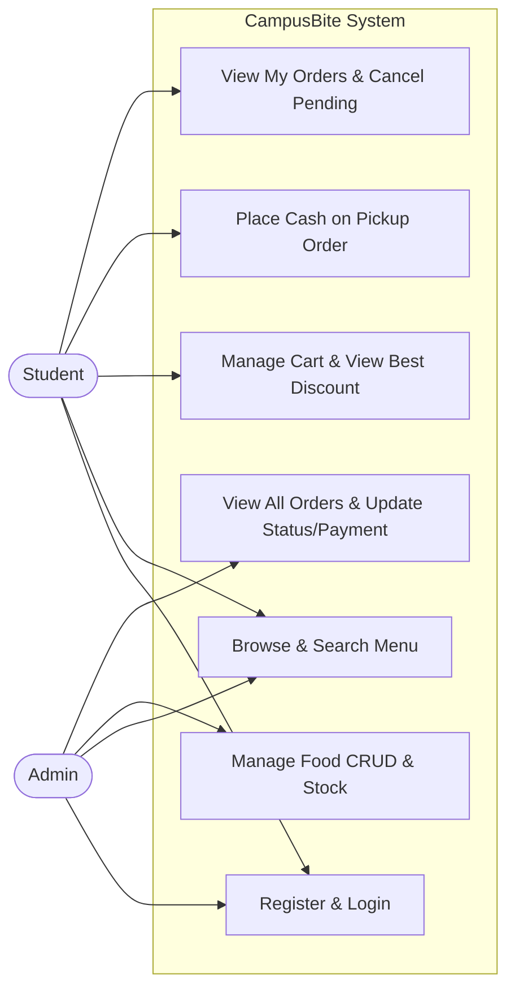
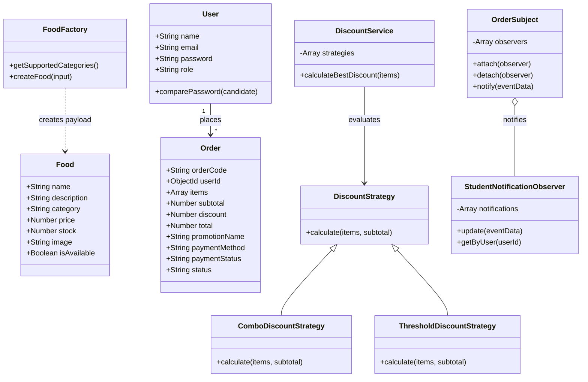
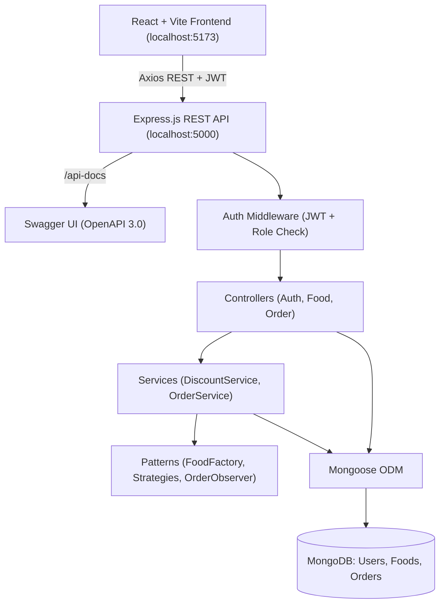
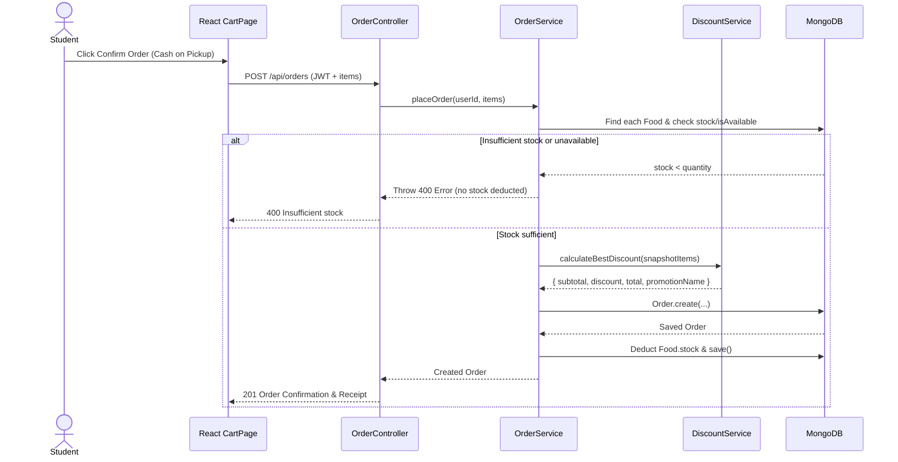

# CampusBite – UML & System Diagrams

All four diagrams below reflect the actual CampusBite implementation.

## 1. Use Case Diagram

## 2. UML Class Diagram (Including Design Patterns)

## 3. System Architecture Diagram

## 4. Order Placement Sequence Diagram

